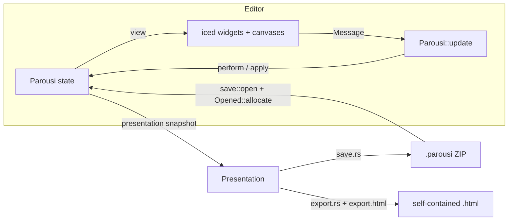
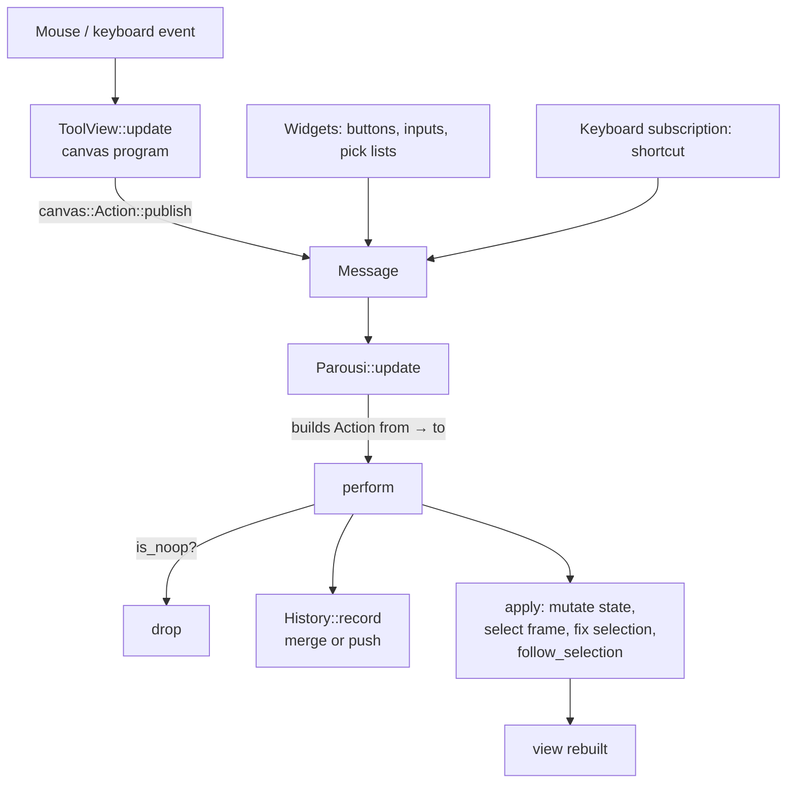

# Parousi architecture

This document explains how Parousi works internally: how state is organized, how input becomes edits, how the board is rendered, and how presentations are saved, reopened and exported. It assumes basic familiarity with Rust and with [iced](https://iced.rs)'s Elm-style architecture (state → `view` → messages → `update`).

Code is referenced by **symbol name** (e.g. `Parousi::update`, `Camera::interpolate`) rather than by line number, so the references stay valid as the code changes.

---

## Contents

1. [Overview](#1-overview)
2. [Source map](#2-source-map)
3. [Application shell](#3-application-shell)
4. [State model](#4-state-model)
5. [Messages, update and subscriptions](#5-messages-update-and-subscriptions)
6. [Coordinate systems and the camera](#6-coordinate-systems-and-the-camera)
7. [The drawing model: `Item` and `Shape`](#7-the-drawing-model-item-and-shape)
8. [Rendering pipeline](#8-rendering-pipeline)
9. [Input handling: `ToolView`](#9-input-handling-toolview)
10. [The style panel](#10-the-style-panel)
11. [Undo and redo](#11-undo-and-redo)
12. [Frames, transitions and flights](#12-frames-transitions-and-flights)
13. [Images and the background](#13-images-and-the-background)
14. [Fonts](#14-fonts)
15. [Save format (`.parousi`)](#15-save-format-parousi)
16. [HTML export](#16-html-export)
17. [The vendored `iced_wgpu` patch](#17-the-vendored-iced_wgpu-patch)
18. [Constants reference](#18-constants-reference)
19. [Extending Parousi](#19-extending-parousi)
20. [Known limitations](#20-known-limitations)

---

## 1. Overview

Parousi is a single-binary Rust crate (edition 2024) with a GUI built on **iced 0.14**. The user draws **items** on a **board**. A presentation is a list of **frames**, and each frame holds only a **camera** (zoom, rotation, offset) and the **transition** used to reach it. Items are shared by all frames, so every frame shows the same drawing through a different camera.

The same presentation model feeds three outputs:



### Dependencies

| Crate | Used for |
| --- | --- |
| `iced` 0.14 (`advanced`, `canvas`, `image`) | Windows, widgets, `Canvas` drawing, GPU image allocation, text measurement through the advanced text API |
| `rfd` 0.17 | Asynchronous native file dialogs. On Linux it uses the XDG portal and falls back to `zenity`. |
| `resvg` 0.45 (with `usvg`, `tiny-skia`) | Parsing and rasterizing SVG, and normalizing SVG (text converted to paths, linked images embedded) for storage and export |
| `image` 0.25 | Identifying formats, decoding formats that the renderer or browsers can't handle, re-encoding to PNG, applying EXIF orientation |
| `zip` 9 (deflate only) | The `.parousi` container |
| `serde`, `serde_json` | The save manifest and the export payload |
| `base64` | `data:` URLs in the exported page |

`iced_wgpu` is patched through `[patch.crates-io]` with a vendored copy (see [§17](#17-the-vendored-iced_wgpu-patch)).

---

## 2. Source map

| File | Lines | Responsibility |
| --- | --- | --- |
| `src/main.rs` | ~4300 | Everything in the editor: the app state, UI layout, data model, geometry, camera, canvas programs, tool interaction, and undo/redo |
| `src/save.rs` | ~800 | The `.parousi` format: serialization, validation, two-phase loading |
| `src/export.rs` | ~310 | Builds the JSON payload for the HTML export, converts images, embeds fonts |
| `src/export.html` | ~460 | The page template and the vanilla-JS player that redraws the presentation on a `<canvas>` |
| `src/typeface.rs` | ~155 | Lists installed fonts, loads font files, interns family names |
| `vendor/iced_wgpu/` | — | iced's wgpu renderer 0.14.0, with one shader fix |

`main.rs` is organized top-down, in this order:

1. Entry point, `Mode`, `Tool`, the help text `USAGE`, and the panel layout `PALETTE`.
2. `Message`, `Parousi` (state), `Presentation` (snapshot).
3. `impl Parousi`: `new`, `update`, `subscription`, `title`, save/perform/apply helpers, and the view builders (`view`, `about`, `workspace`, `palette`, `toolbar`, `timeline`, …).
4. Free UI helpers: `swatch`, `input_style`, `action_button`, `shortcut`.
5. Board sizing: `BoardSize`, `AspectRatio`, and the parse helpers.
6. Undo: `Action`, `History`.
7. Camera and angle math: `Camera`, `rotated`, `wrapped`, `angle_between`.
8. Frames: `Frame`, `TransitionKind`, `Transition`, `Flight`.
9. Style: `COLORS`, `Style`, `Settings`, `Ink`, `Corners`, `TextSize`.
10. Model: `Item`, `Shape`, and the geometry helpers (`paint`, `polyline`, `segments`, `distance_to_segment`, `encloses`, `enclosing`, `arrow_head`, `shape`, `polygon`, `text_size`, `fit`).
11. Pictures and background: the scale math, `pick_picture`, `load_picture`, `parse_svg`, `rasterize_svg`, `resolve_generic_families`, `Picture`, `Background`.
12. Canvas programs: `BackgroundView`, `BoardView`, `ItemsView`.
13. Interaction: constants, `Interaction`, `Trail`, `Grab`, `Turn`, `Edit`, `Draft`, `ToolView`.

---

## 3. Application shell

```rust
iced::daemon(Parousi::new, Parousi::update, Parousi::view)
    .subscription(Parousi::subscription)
    .title(Parousi::title)
    .theme(THEME)   // Theme::Dark
    .run()
```

Parousi uses `iced::daemon` rather than `iced::application` because it can have **two windows**: the editor (`main_window`) and an optional **About** window (`about_window`). A daemon doesn't open a window by itself, so `Parousi::new` opens the 1280×800 main window with `window::open`.

- `view(window)` and `title(window)` take the window id. The About window renders `Parousi::about`, a scrollable list built from the `USAGE` constant. The main window's title is `"<file stem> — Parousi"` once the presentation has a path.
- `Message::About` either focuses the existing About window or opens a new one (560×680).
- `Message::WindowClosed`: closing the **main** window calls `iced::exit()`. Closing the About window only clears `about_window`.
- `THEME` is also used by the exporter, so the exported page's surround color matches the editor workspace.

---

## 4. State model

`Parousi` holds three kinds of state. Keeping them apart determines what is saved, what is undoable, and what is neither.

| Field | Kind | Saved | Undoable |
| --- | --- | :-: | :-: |
| `board_size: BoardSize` | Presentation | ✓ | ✓ |
| `frames: Vec<Frame>` (never empty) | Presentation | ✓ | ✓ |
| `items: Vec<Item>` (draw order) | Presentation | ✓ | ✓ |
| `background: Option<Background>` | Presentation | ✓ | ✓ |
| `workspace: Size` | Presentation (as `view`) | ✓ | — |
| `keep_aspect_ratio`, `mode`, `tool`, `corners` | Editing preference | — | — |
| `style: Style` (for new items) | Editing preference | — | — |
| `selection_style: Style` | Panel mirror of the selected item | — | — |
| `frame: usize`, `selected: Option<usize>` | Selection | — | — |
| `flight: Option<Flight>` | Animation | — | — |
| `history: History` | Undo | — | — |
| `typefaces: combo_box::State<Typeface>` | Font picker options | — | — |
| `path: Option<PathBuf>` | Current file | — | — |
| `main_window`, `about_window` | Windows | — | — |

The design rule, which also appears in the code comments: settings that describe **how you edit** (tool, mode, corners, new-item style, aspect-ratio lock) are not undoable. Only changes to the **presentation itself** are.

### `Presentation`: a snapshot for background work

`Parousi::presentation()` clones the presentation-tier fields into a `Presentation { view, board_size, frames, items, background }`. Save and export run asynchronously on that snapshot, so editing can continue while files are written. The clone is cheap because heavy data is reference-counted: image bytes are `Arc<[u8]>`/`Arc<str>`, fonts are `Arc<FontFile>`, and GPU images are `image::Allocation` handles.

### The "value + input" pattern

Every text input that edits a number or color stores **both** the raw string and the last valid parsed value:

| Type | String field | Value field | Valid when |
| --- | --- | --- | --- |
| `BoardSize` | `width`, `height` | `size` | a whole number > 0 (`parse_side`) |
| `AspectRatio` | `width`, `height` | `value` (w/h) | both > 0 and the ratio is normal |
| `Ink` | `input` | `color` | 3/4/6/8 hex digits, `#` optional (`parse_color`) |
| `TextSize` | `input` | `value` | 0 < size ≤ `MAX_TEXT_SIZE` (1000) |
| `Corners` | `input` | `count` | 3 ≤ n ≤ 100 |
| `Transition` | `duration_input` | `duration` | parses as `f32` seconds that make a valid `Duration` |
| `Background` | `parallax_input` | `parallax` | 0 ≤ p ≤ 100 |

While a string doesn't parse (for example `"12."` mid-typing), the value keeps its last valid state, and `input_style(is_valid)` draws the input with a red border. The string is part of the state, so undo restores exactly what was typed.

`parse_color` rejects non-ASCII-hex input **before** calling `Color::from_str`, because iced's parser slices by byte and would panic inside a multi-byte character.

---

## 5. Messages, update and subscriptions

### Message groups

| Group | Messages |
| --- | --- |
| Board | `AspectWidthChanged`, `AspectHeightChanged`, `AspectRatioToggled`, `BoardWidthChanged`, `BoardHeightChanged` |
| Tools and style | `ModeSelected`, `ToolSelected`, `ColorPicked`, `ColorInputChanged`, `FilledToggled`, `TextSizeChanged`, `TypefacePicked`, `PickFontFile`, `FontFileLoaded`, `CornersChanged` |
| Camera | `CameraMoved(Vector)`, `CameraRotated(f32)`, `CameraZoomed { anchor, factor }`, `CameraGrabbed`, `Released` |
| Items | `ItemDrawn`, `ItemSelected`, `ItemEdited`, `DeleteItem`, `PlaceImage`, `ImageLoaded` |
| Background | `PickBackground`, `BackgroundLoaded`, `RemoveBackground`, `BackgroundParallaxChanged` |
| Frames | `FrameSelected`, `AddFrame`, `DeleteFrame`, `TransitionKindSelected`, `TransitionDurationChanged`, `Tick(Instant)` |
| History | `Undo`, `Redo` |
| Files | `Open`, `Opened`, `Save`, `SaveAs`, `Saved`, `Export`, `Exported` |
| Windows | `About`, `WindowClosed`, `WorkspaceResized(Size)` |

### Editing flow

Every message that changes the presentation becomes an `Action` and goes through `Parousi::perform`:



### Async work

File dialogs and heavy I/O never run directly inside `update`. They follow this pattern:

```rust
let dialog = rfd::AsyncFileDialog::new() /* … */ .pick_file();
Task::future(async move {
    let path = dialog.await?.path().to_owned();   // None if cancelled
    Some(do_heavy_work(&path))
})
.and_then(Task::done)                           // drops the None (cancel)
.map(Message::Something)
```

Long chains add GPU work with further `Task`s. For example, opening a file runs `save::open` in a future, then `Opened::allocate()` (font loading and image allocation tasks), and finally emits `Message::Opened`. Errors are `Arc<io::Error>` so that messages stay `Clone`. Failures are reported with `eprintln!` only (see [§20](#20-known-limitations)).

### Subscriptions

`Parousi::subscription` batches three subscriptions:

1. **Shortcuts.** `event::listen_with` keeps only keyboard events whose status is `event::Status::Ignored`, meaning no widget or canvas captured them, and only from the main window. `.with(self.main_window)` passes the window id into the stateless filter. `shortcut()` maps them:
   - Without the command modifier: `Delete`/`Backspace` → `DeleteItem`, `Escape` → `ItemSelected(None)`.
   - With command (Ctrl, or Cmd on macOS): `z` → Undo, `Shift+z`/`y` → Redo, `s` → Save, `Shift+s` → SaveAs, `o` → Open. Keys are matched with `key.to_latin(physical_key)`, so the shortcuts still work with non-Latin layouts such as Cyrillic.
2. **`window::close_events()`** → `WindowClosed`.
3. **`window::frames()`** → `Tick`, subscribed **only while a `Flight` is active**. Otherwise the app is idle and doesn't redraw every frame.

The "ignored only" rule matters. While you type into a text input, or while `ToolView` captures a key (text typing, path editing), Backspace and Escape don't reach the global shortcuts. That's why Backspace while writing text deletes a character instead of the selected item.

---

## 6. Coordinate systems and the camera

Four coordinate spaces are in play. The y axis points **down** in all of them, so a positive angle turns **clockwise** on screen.

| Space | Origin | Units | Converted by |
| --- | --- | --- | --- |
| Canvas | top-left of the workspace canvas | screen px | — |
| Centered screen | canvas center | screen px | `position - bounds.center()` |
| Board | board center (the board spans `±w/2, ±h/2`) | board units | `Camera::to_board` |
| Item-local | board origin, rotated back by `item.rotation` | board units | `Item::to_local` / `Item::to_board` |

### `Camera`

```rust
struct Camera {
    zoom: f32,       // screen px per board unit, clamped to [0.1, 10]
    rotation: f32,   // clockwise, in [0, 2π)
    offset: Vector,  // board center relative to canvas center, in screen px
}
```

Board to centered screen: **s = R(rotation) · (zoom · b) + offset**

- `Camera::apply(frame)` sets up a canvas frame with `translate(center + offset)`, then `rotate(rotation)`, then `scale(zoom)`. After that, drawing happens in board coordinates.
- `Camera::to_board(s)` is the inverse: **b = R(−rotation) · (s − offset) / zoom**.
- `Camera::rotate(angle)` rotates the *offset* as well, so the camera turns around the **canvas center** (what's in the middle of the screen stays there).
- `Camera::zoom_at(anchor, factor)` keeps the board point under `anchor` fixed: **offset' = anchor − (anchor − offset) · zoom'/zoom**.

The camera doesn't depend on the canvas size. Resizing the window shows more or less around the board but never rescales it, which is also why the export records the workspace size (see [§16](#16-html-export)).

### Angle helpers

- `rotated(v, a)` turns a vector clockwise on screen.
- `wrapped(a)` maps an angle to `[−π, π)`, the short way round.
- `angle_between(from, to)` = `atan2(cross, dot)`, the signed clockwise angle between two directions.

### Item rotation

An item's `shape` is stored in **item-local** coordinates, and `rotation` turns those coordinates around the **board origin**, not around the item's own center. This keeps drawing trivial (`frame.rotate(item.rotation); shape.draw(frame)`, and `context.rotate(item.rotation)` on the web page). It also means resize math works on the item's own, axis-aligned extent.

To make an item *appear* to turn around its own center, `Item::turned(center, angle)` compensates for the drift:

```
drift = c − R(angle)·c          // how far turning around the origin moves c
shape' = shape.translated(R(−rotation')·drift)
```

`Item::translated(delta)` similarly rotates a board-space delta into local space before it moves the points.

---

## 7. The drawing model: `Item` and `Shape`

```rust
struct Item { shape: Shape, rotation: f32 }

enum Shape {
    Polyline { points: Vec<Point>, closed: bool, filled: bool, color: Color },
    Arrow    { from: Point, to: Point, color: Color },
    Ellipse  { center: Point, radii: Vector, filled: bool, color: Color },
    Text     { position: Point, content: String, size: f32, typeface: Typeface, color: Color },
    Image    { bounds: Rectangle, picture: Picture },
}
```

| Tool | Produces |
| --- | --- |
| Line | open 2-point `Polyline` |
| Rectangle | closed 4-point `Polyline` |
| Polygon | closed `Polyline` with *n* corners (`polygon(center, corner, n, None)`) |
| Star | closed `Polyline` with 2*n* points, dents at `STAR_DENT` = 0.5 of the radius |
| Pencil | open `Polyline`, with points at least `PENCIL_STEP` (2 screen px) apart |
| Path | open, or closed and optionally filled, `Polyline` |
| Arrow | `Arrow` |
| Ellipse | `Ellipse` |
| Text | `Text` |
| Image | `Image` |

Rectangles are polylines rather than a separate variant, so rotation, resize and hit testing need no special cases.

### `Shape` operations

| Method | Purpose |
| --- | --- |
| `draw(frame)` | Strokes or fills via `paint` (even-odd fill, round caps and joins, `LINE_WIDTH` = 3). Arrows stroke the shaft to the head's base, then fill the head. Text uses `frame.fill_text` with a line height of 1.2. |
| `mapped(map, factors)` | The core transform: maps every point with `map`, and scales ellipse radii, image size and text size by `factors`. Line thickness doesn't change. |
| `translated(delta)` / `scaled(anchor, factors)` | Thin wrappers around `mapped` |
| `keeps_proportions()` | `true` for text, which can only resize uniformly |
| `color()` / `filled()` / `text_style()` | Which style properties the shape has. `filled()` is only `Some` for closed polylines and ellipses. |
| `settings()` | Packs the three above into `Settings { color, fill, text }`, which tells the panel which controls to enable |
| `styled(style)` | Returns a copy with the applicable parts of `Style` applied |
| `extent()` | Axis-aligned bounds in local space, ignoring stroke width. For text it is measured with `text_size()`. |
| `hits(point, distance)` | Hit test in local space (see below) |

### Geometry helpers

- **`shape(tool, start, end, corners, color, filled)`** builds the shape for a drag, or `None` if it would be empty (zero width or height for rectangles and ellipses, `start == end` for the others).
- **`polygon(center, corner, n, dent)`** generates regular polygons and stars by rotating the radius vector `corner − center` by `2π/n` steps. With `dent`, it adds a point at `dent × radius`, half a step further.
- **`arrow_head(from, to)`** returns the shaft end and the triangle `[tip, base+side, base−side]`. The head is 15 long and 12 wide, and shrinks proportionally when the arrow is shorter than the head.
- **`text_size(content, size, font)`** builds an iced `Paragraph` with unbounded size and no wrapping and returns `min_bounds()`. This is the same layout engine (cosmic-text) the canvas uses to draw.
- **`fit(size, area)`** returns the largest rectangle with `size`'s aspect ratio that fits centered in `area`. It's used for placing images.

### Hit testing

`Item::hits` converts the point to local space, then:

- **Polyline**: within `distance + LINE_WIDTH/2` of any segment (`distance_to_segment`), **or** inside a closed one by the **even-odd** rule (`encloses`). Even-odd matches the fill rule, so a self-intersecting star is clickable exactly where it appears filled. Unfilled shapes can also be clicked inside, because their thin outlines are hard to hit.
- **Arrow**: near the shaft, or inside the head triangle.
- **Ellipse**: inside the ellipse with both radii grown by the reach.
- **Text, Image**: inside the extent, expanded by `distance`.

`ToolView::item_at` searches from the top with `rposition`, using `HIT_DISTANCE / zoom` (6 screen px).

---

## 8. Rendering pipeline

The workspace is a `Stack` of full-size `Canvas` layers inside a `sensor` (which reports the workspace size as `WorkspaceResized`):

```
sensor ─ container (workspace color) ─ Stack
   ├─ backdrop:  BackgroundView  (if a background is set)
   │             BoardView       (otherwise: white board rectangle)
   ├─ ItemsView  run 1
   ├─ ItemsView  run 2
   ├─ …
   └─ ToolView   (selection outline, handles, draft preview, input handling)
```

### Why items are split into runs

Within a single iced canvas `Frame`, primitives are batched by kind: **meshes first, then images, then text**, regardless of the order of the draw calls. If everything were drawn into one canvas, a rectangle drawn after an image would end up underneath it.

`Parousi::workspace` solves this with `self.items.chunk_by(Item::shares_canvas)`. Each chunk gets its own `ItemsView` canvas, and the `Stack` orders the canvases. `shares_canvas(prev, next)` is:

| prev \ next | shape | text | image |
| --- | :-: | :-: | :-: |
| **shape** | ✓ | ✓ | ✓ |
| **text** | ✗ | ✓ | ✗ |
| **image** | ✗ | ✗ | ✓ |

So every run has the form *shapes\* followed by (texts\* or images\*)*. Within a run, the renderer's own layering (shapes below images or text) then matches draw order.

### Canvas programs

- **`BoardView`** applies the camera and fills the board with `canvas::Path::rectangle`. It deliberately avoids `fill_rectangle`, because the wgpu backend keeps that axis-aligned and would squash the board when the camera rotates.
- **`BackgroundView`** draws the background in screen space (see [§13](#13-images-and-the-background)). When there is a background, the board itself isn't drawn, so only the items appear over the image. The exported page does the same.
- **`ItemsView`** applies the camera and calls `Item::draw` for its slice of items.
- **`ToolView`** applies the camera and draws:
  - the **selection outline** (`outline()` = extent expanded by `LINE_WIDTH/2 + SELECTION_GAP/zoom`), the square **resize handles**, and the round **turn handle** with its stem. All of these are drawn in the item's local frame so they rotate with it, and their sizes are multiplied by `pixel = 1/zoom` so they stay a constant size on screen;
  - the **draft preview** (`ToolView::item(draft)` drawn like a real item), plus extras: a dashed rectangle for the image area, a rubber-band segment and a close circle for paths, and the text caret.

No `canvas::Cache` is used, so every layer is redrawn whenever the view is rebuilt.

---

## 9. Input handling: `ToolView`

`ToolView` is rebuilt on every `view()` call, with borrowed references to the items, selection, style and camera. It implements `canvas::Program<Message>` with `State = Interaction`, which iced keeps in the widget tree between events:

```rust
struct Interaction {
    modifiers: keyboard::Modifiers,
    trail: Trail,              // recent cursor positions, used to measure speed
    grab: Option<Grab>,        // what is being dragged
    draft: Option<Draft>,      // item being drawn
    click: Option<Click>,      // for double-click detection
}
```

`ToolView` never mutates app state directly. It **publishes messages**. Button presses on the canvas, handled key presses and Ctrl+scroll are marked `.and_capture()`, so they don't reach other widgets or trigger a global shortcut. Cursor moves and releases aren't captured.

### Event dispatch (`ToolView::update`)

| Event | Handler |
| --- | --- |
| `ModifiersChanged` | stores the modifiers |
| `KeyPressed` | `key_press`: edits the text or path draft; ignored if a command modifier is held |
| `WheelScrolled` with **Ctrl** | `CameraZoomed { anchor, factor: 1.1^lines }`; pixel deltas count as `pixels / 50` lines |
| Left `ButtonPressed` | `press` |
| `CursorMoved` | `cursor_moved` |
| Left `ButtonReleased` | `release` |

### Pressing, per tool (`press`)

- **Pressing outside the canvas** finishes any text or path draft and lets the click continue to the widget that was clicked (for example, a tool button).
- **Select**: `grabbed_at(point)` chooses, in priority order: (1) a **handle** of the selected item within `HANDLE_REACH` (8 px); (2) the **topmost item** under the cursor (→ `Edit::Move`); (3) anywhere inside the **selected item's outline** (→ `Edit::Move`, so a hollow selected shape can be dragged from inside). If it finds an item, it becomes a `Grab::Item` holding a **snapshot** of the item and the start point. Otherwise it becomes `Grab::Camera`. Either way it publishes `ItemSelected(index or None)`, which also seals the undo history.
- **Pan**: always `Grab::Camera` and `CameraGrabbed`.
- **Line, Arrow, Rectangle, Ellipse, Polygon, Star, Image**: start a `Draft::Drag { tool, start, end }`.
- **Pencil**: start a `Draft::Stroke(vec![point])`.
- **Path**: the first click starts a `Draft::Path`. Later clicks either **close** it (at least 3 points and within `CLOSE_DISTANCE` = 8 px of the first point; publishes a closed polyline using the current fill setting), **finish** it on a double click (the first click of the pair already added the last point), or **append** a point.
- **Text**: finishes any text draft in progress, then starts a new `Draft::Text` at the click.

### Dragging (`cursor_moved`)

Each move first updates `Trail` and computes the cursor speed over the last `SPEED_WINDOW` (100 ms). The cursor counts as "slow" below `SLOW_TURN_SPEED` (300 px/s).

- **`Grab::Camera`**:
  - In `Mode::Move`, publishes `CameraMoved(position − last)`.
  - In `Mode::Rotate`, the board turns like a knob. The turn angle is `angle_between(last − center, position − center)`, passed through `Turn::to` for right-angle stops, and published as an **absolute** rotation `CameraRotated(r)`. `update` then calls `camera.rotate(wrapped(r − current))`.
- **`Grab::Item`**: computes `edited(snapshot, edit, start, point, shift)` from the **original snapshot**, so errors don't accumulate during a drag, and publishes `ItemEdited(item)`:
  - **Move**: `snapshot.translated(point − start)`.
  - **Turn**: the angle swept around `item.center()`. With Shift, the absolute rotation snaps to `TURN_STEP` (15°). Without Shift, the result passes through `Turn::to` for right-angle stops.
  - **Resize(side)**: `side` is one of the 8 unit directions in `RESIZE_SIDES`. The dragged edge or corner is `c + side⊙extent/2`, and the **anchor** is the opposite one. The drag delta is rotated into local space, and per-axis factors are `(size + delta·side) / size`. Each factor is limited so the item can't shrink below `MIN_RESIZE` (4 screen px) unless it was already smaller. With Shift, or for text, a corner drag uses the projection of `(diagonal + delta)` onto the diagonal, and a side drag uses that axis's factor uniformly. The result is `shape.scaled(anchor, factors)`.
- **Drafts**: `Drag` updates `end`. `Stroke` appends the point if it's at least `PENCIL_STEP` from the last one. `Path` updates the rubber-band cursor.

### Right-angle stops (`Turn`)

```rust
struct Turn { free: f32, stop: Option<f32> }
```

`free` is the **unwrapped** rotation the cursor is dragging toward, so it changes continuously and never jumps at 2π. `Turn::to(rotation, slow)`:

1. Advances `free` by the short-way difference to `rotation`.
2. If currently stopped, it **holds** at the stop until `free` is more than `RIGHT_ANGLE_HOLD` (10°) away from it.
3. Otherwise, it finds the nearest multiple of 90°. If the movement **crossed or landed on** it (and didn't *start* on it, so a drag that begins at 0° can leave it), the cursor is slow, and the new value is within the hold range, it stops there.

Fast drags therefore pass straight through right angles, and slow drags stop on them. The same logic is used for camera rotation and item turning.

### Releasing and keys

- `release`: if a grab was active, it publishes `Released`, which seals the history so the whole drag undoes as one step. `Drag` and `Stroke` drafts finish here. `Path` and `Text` drafts stay open.
- `key_press` (no command modifier):
  - **Text draft**: Escape finishes it, Enter inserts `\n`, Backspace removes the last character, and any other key appends its `text` (control characters are filtered out).
  - **Path draft**: Enter finishes it (open), Escape discards it, and Backspace removes the last point (discarding the draft when none are left).

`ToolView::finish(draft)` turns a draft into its message: `PlaceImage(area)` for an image drag, `ItemDrawn(item)` for the others, or nothing if the result would be empty (a single point, or whitespace-only text). `publish_or_redraw` redraws anyway, so an empty draft disappears from the screen.

### Image placement

`image_area(start, end)` uses the dragged rectangle if its shorter side is at least `MIN_IMAGE_DRAG` (8 screen px). Otherwise it uses a rectangle of `IMAGE_AREA` (50 %) of the board size, centered on the click. `PlaceImage(area)` opens the file picker, and when `ImageLoaded` arrives, the item's bounds are `fit(picture.size(), area)`.

### Cursor icons (`mouse_interaction`)

Grabbing shows `Grabbing` (or the edit cursor). Drag and stroke drafts show `Crosshair`. With Select, the icon reflects what `grabbed_at` would pick. Resize cursors are chosen by rotating the side direction by `item.rotation + camera.rotation` and rounding the angle (mod π) to 45° steps, which gives horizontal, diagonal-down, vertical or diagonal-up.

### Handles (`ToolView::handles`)

There are eight resize handles around the outline, plus a turn handle `TURN_HANDLE_DISTANCE` (24 px) above it. They're filtered for usability:

- Shapes that keep their proportions (text) get only the **corners**.
- If the outline is narrower than `2 × HANDLE_SIZE` on screen in one direction, only the handles along the other direction remain. For example, a horizontal line gets only its left and right handles.
- If it's too small in both directions, only the corners remain.

---

## 10. The style panel

The **Color** and **Text** sections of the panel serve two purposes:

- **No selection**: they edit `self.style`, which is used for **new items**. This isn't undoable. Controls are enabled according to the current tool: color always, *Filled* if `tool.can_fill()`, and text controls only for the Text tool.
- **An item selected**: they edit `self.selection_style`, and each change is immediately applied to the item as an `Action::ItemChanged` (with `shape.styled(&selection_style)`). Controls are enabled according to `item.shape.settings()`. Section titles show *Selected item*.

`Parousi::panel_style()` returns the style to show together with the `Settings` mask.

Key mechanics:

- **`ItemSelected`** first copies `style` into `selection_style` (so settings the item doesn't have, such as text size on a rectangle, show the new-item values), then calls `follow_selection()`.
- **`follow_selection()`** runs after **every** `apply`, including undo and redo. It calls `Style::follow(shape)`, which copies the item's color, fill, text size and font into the panel, but **keeps the input string if the value hasn't changed**. That way, typing `#2563e` (invalid) on a blue item isn't overwritten.
- **`restyle(change)`** is used for typing (color hex, text size). Repeated edits merge into one undo step.
- **`restyle_once(change)`** is used for discrete picks (a swatch, *Filled*, a font). It seals the history before and after, so the pick is its own undo step.
- A `combo_box` can't be disabled, so when text settings don't apply, the font control is replaced with a read-only `text_input` that shows the font name.

---

## 11. Undo and redo

### `Action`

Each variant holds enough data to apply the change in either direction:

| Variant | Inverse | Merges with the next action when… |
| --- | --- | --- |
| `BoardSize { from, to }` | swap | the next is also `BoardSize` |
| `Background { from, to }` | swap | both are `Some → Some` with the same picture (only the parallax changed) |
| `Camera { frame, from, to }` | swap | same frame |
| `Transition { frame, from, to }` | swap | same frame and the kind is unchanged in both (only the duration was typed) |
| `ItemAdded { index, item }` | `ItemRemoved` | never |
| `ItemRemoved { index, item }` | `ItemAdded` | never |
| `ItemChanged { index, from, to }` | swap | same index |
| `FrameAdded { index, frame }` | `FrameDeleted` | never |
| `FrameDeleted { index, frame }` | `FrameAdded` | never |

`Action::is_noop` drops actions where `from == to`, such as zooming past the limit. Most model types derive `PartialEq` for this check.

### `History`

```rust
struct History { done: Vec<Action>, undone: Vec<Action>, open: bool }
```

- `record(action)` clears `undone`. If `open` is set and the last action can `merge` the new one, it updates that action's `to` in place. Otherwise it pushes the new action and sets `open = true`.
- `seal()` sets `open = false`, so the next action starts a new step. Sealing happens on: `CameraGrabbed`, `Released`, `ItemSelected`, `FrameSelected`, `AspectRatioToggled`, around `restyle_once`, and after every undo or redo.
- `undo()` pops from `done`, pushes the action to `undone`, and returns its **inverse** to apply. `redo()` does the reverse.

As a result, a drag, a run of Ctrl+scroll steps, or typing in one input each undo as **one** step. A scroll followed by a drag are separate steps, because the drag seals on grab and on release.

### `perform` vs `apply`

`perform` = `is_noop` check, then `history.record`, then `apply`. Undo and redo call `apply` directly (and cancel any `flight`, so they jump straight to the result). `apply` also keeps the UI consistent:

- `Camera` actions **select their frame** and cancel the flight, so undoing a camera move shows the frame it affected.
- `ItemAdded` and `ItemRemoved` shift `selected` so the selection stays on the same item. Removing the selected item clears the selection.
- `FrameAdded` selects the new frame. `FrameDeleted` selects the previous one.
- `follow_selection()` runs at the end.

---

## 12. Frames, transitions and flights

```rust
struct Frame { camera: Camera, transition: Transition }
struct Transition { kind: TransitionKind, duration: Duration, duration_input: String }
enum TransitionKind { Instant, Linear, Sine }
```

- `frames` is **never empty**. `DeleteFrame` is disabled for a single frame, and opening a file rejects a presentation with no frames.
- `AddFrame` inserts a **copy of the current frame** after it, so you continue from the current view.
- A frame's `transition` describes how the camera **arrives at that frame** from the one before it. The first frame's transition is unused. The timeline draws each transition's controls between the two frames it connects.

### Selecting a frame (`Parousi::select_frame`)

Moving forward to frame `i` uses `frames[i].transition`. Moving backward to `i` uses `frames[i + 1].transition` (the gap you're crossing), so going back and forth between two frames plays the same transition both ways.

The new `Flight` starts from the **currently displayed** camera (`self.camera()`), not from the previous frame's camera, so interrupting a transition mid-flight continues smoothly.

### `Flight`

```rust
struct Flight { from: Camera, kind, duration, start: Option<Instant>, progress: f32 }
```

- `Flight::new` returns `None` for `Instant` or a zero duration, which means the camera jumps.
- `Flight::advance(now)` sets `start` on the **first** `Tick`, so time spent before the first redraw doesn't count. It sets `progress = kind.ease(min(t, 1))` and returns whether the flight has arrived.
- The displayed camera is `flight.from.interpolate(frames[frame].camera, progress)`.
- Any camera edit (`apply(Action::Camera)`), undo or redo cancels the flight.

### Easing and interpolation

```
Linear: e(t) = t
Sine:   e(t) = (1 − cos πt) / 2        // velocity ∝ sin πt
```

`Camera::interpolate(to, a)` interpolates in terms the viewer perceives:

- The **board point at the screen center** moves in a straight line: `c = c₀ + (c₁ − c₀)·a`.
- **Zoom** is geometric: `z = z₀ · (z₁/z₀)^a`, so zooming in and zooming out look equally fast.
- **Rotation** takes the short way: `r = r₀ + wrapped(r₁ − r₀)·a`.
- The offset is reconstructed from these: `offset = R(r) · (−c · z)`.

---

## 13. Images and the background

### `Picture`

```rust
struct Picture { image: image::Allocation, file: ImageFile }

enum ImageFile {
    Raster { data: Arc<[u8]>, format: ImageFormat },  // original bytes, format from the extension
    Vector(Arc<str>),                                  // usvg-normalized SVG text
}
```

- `image::Allocation` (from `iced::widget::image::allocate`) keeps the decoded image **resident on the GPU** while it's held. An image appears immediately when placed, and also when brought back by undo, because the `Action` in the history keeps its `Picture` alive. The allocation also provides the pixel size.
- `ImageFile` holds the source bytes for saving and export.

### Loading (`pick_picture` → `load_picture`)

1. An `rfd` dialog filtered to `RASTER_EXTENSIONS` plus `VECTOR_EXTENSIONS`.
2. `load_picture`, inside a `Task::future`:
   - **Raster**: `image::Handle::from_path` (the renderer decodes it) and `ImageFile::raster` (the bytes, with the format taken from the extension, because some formats such as TGA can't be detected from their data).
   - **Vector**: `parse_svg` → `rasterize_svg(tree, scale(size))` and `ImageFile::vector(tree)`.
3. `image::allocate(handle)` produces the `Picture`.

### SVG handling

- **`parse_svg`** loads system fonts into usvg's fontdb, sets `resources_dir` so relative links resolve, and calls `resolve_generic_families`. That function asks `fc-match` which installed font fontconfig would use for `serif`, `sans-serif`, `monospace`, `cursive` and `fantasy`. Without it, fontdb may choose a preferred font that isn't installed. On systems without fontconfig this step does nothing.
- **`rasterize_svg`** renders **once** with resvg at the scale the image needs for its highest on-screen size. If the renderer rasterized the SVG itself, it would do so again whenever the on-screen size changed, which is every frame of a zoom. Constraints and fixes:
  - The longest side is capped at `MAX_RASTER_SIDE` (8192 px).
  - tiny-skia produces **premultiplied** RGBA, but the renderer expects straight alpha, so each pixel is un-premultiplied (`c·255/α`, rounded).
- The required scale:
  - **Item**: `fit(size, area).width / size.width × MAX_ZOOM`, which is sharp at 10× camera zoom.
  - **Background**: `background_scale(size) = cover_scale(size, 3840×2160) × MAX_BACKGROUND_SCALE (8)`, which is sharp on a 4K screen at maximum background zoom.
- **`ImageFile::vector`** stores `tree.to_string()`, usvg's **normalized** SVG, in which text is already converted to paths and linked images are embedded. Saved and exported SVGs therefore look the same everywhere, without the original fonts or linked files.

### Background drawing (`BackgroundView::draw`)

All values are in screen space. *p* is the parallax as a fraction (0–1), *S* the screen size and *I* the image size:

```
room   = S · p / 2                                  // how far it may drift each way
rel    = camera.zoom / fit_scale(board, S)          // 1 = whole board fits on screen
z      = clamp(rel ^ 0.5, 1, 8 / (1 + p))           // background_zoom
size   = I · cover_scale(I, S) · (1 + p) · z
across = clamp(board_center_on_screen / (board/2), −1, 1)   // where the camera looks, per axis
middle = screen_center − across ⊙ room · z
draw image centered at `middle` with `size`
```

Why the edges never show: the image covers at least `S·(1+p)·z`, so the margin on each side is `S·((1+p)·z − 1)/2`. The maximum drift is `S·p·z/2`, and `(1+p)·z − 1 ≥ p·z` whenever `z ≥ 1`. The clamp `z ≥ 1` therefore guarantees full coverage. The upper clamp limits growth to `MAX_BACKGROUND_SCALE`, which is also the scale the SVG was rasterized for.

`BACKGROUND_ZOOM_POWER = 0.5` means the background zooms 2× when the board zooms 4×, which looks like a distant scene.

---

## 14. Fonts

`src/typeface.rs`:

```rust
enum Typeface {
    Default,                 // iced's default sans-serif
    System(&'static str),    // installed family, saved by name
    File(Arc<FontFile>),     // loaded file, embedded in saves and exports
}

struct FontFile { family: &'static str, data: Arc<[u8]> }
```

- **`installed()`** reads the faces in iced's global cosmic-text `font_system()` database. It skips `fontdb::Source::Binary` faces (the renderer's built-in fonts and fonts loaded from files) and families starting with `.` (hidden macOS UI fonts that browsers can't reference), deduplicates them through a `BTreeSet`, and sorts them case-insensitively.
- **`intern(name)`**: `iced::Font::with_name` needs a `&'static str`. Names are leaked **once each** through a global `Mutex<BTreeSet<&'static str>>`, which keeps the leak bounded.
- **`FontFile::new(data)`** parses the bytes with a private `fontdb::Database` to find the first family name, and fails with `InvalidData` if the data isn't a font.
- **`FontFile::extension()`** returns `"otf"` if the data starts with `OTTO` (CFF outlines), otherwise `"ttf"`.
- **`FontFile::load()`** returns `iced::font::load(data)` as a `Task`, which registers the font with the renderer.

Picking a font file (`Message::PickFontFile`): the dialog runs, the file is read in a future, the font is **loaded into the renderer first**, and then `FontFileLoaded(Ok(file))` is emitted, so text appears in the new font immediately. `add_font_file` removes duplicates (`FontFile: PartialEq` compares family and bytes) and inserts the font into the picker **after Default and the other files, before the installed fonts**.

When a presentation is opened, all of its font files are loaded before the images are allocated, and every font used by text is added to the picker.

---

## 15. Save format (`.parousi`)

A `.parousi` file is a **ZIP archive** (Deflate):

```
presentation.parousi
├── presentation.json      ← manifest
├── images/0.png           ← one entry per distinct image (deduplicated by content)
├── images/1.svg
└── fonts/0.ttf            ← one entry per distinct font file
```

### Manifest (version 1)

```json
{
  "format": "parousi",
  "version": 1,
  "view": [980.0, 535.0],
  "board": { "size": [640.0, 480.0], "aspectRatio": [4.0, 3.0] },
  "background": { "image": "images/0.jpg", "parallax": 10.0 },
  "frames": [
    {
      "camera": { "zoom": 1.0, "rotation": 0.0, "offset": [0.0, 0.0] },
      "transition": { "kind": "linear", "duration": 1.0 }
    }
  ],
  "items": [
    { "type": "polyline", "points": [[-100.0, -50.0], [100.0, -50.0], [100.0, 50.0], [-100.0, 50.0]],
      "closed": true, "filled": false, "color": "#2563eb", "rotation": 0.0 },
    { "type": "arrow", "from": [0.0, 0.0], "to": [120.0, 40.0], "color": "#dc2626", "rotation": 0.0 },
    { "type": "ellipse", "center": [0.0, 0.0], "radii": [40.0, 20.0], "filled": true,
      "color": "#16a34a80", "rotation": 0.5 },
    { "type": "text", "position": [-80.0, -120.0], "content": "Hello\nworld", "size": 32.0,
      "font": { "file": "fonts/0.ttf" }, "color": "#000000", "rotation": 0.0 },
    { "type": "image", "bounds": [-50.0, -50.0, 100.0, 75.0], "image": "images/1.png", "rotation": 0.0 }
  ]
}
```

Notes on the schema:

- All coordinates are in editor units: board units for items, and screen px for `camera.offset` and `view`. Item geometry is in **item-local** coordinates, with `rotation` around the board origin.
- Colors are `#rrggbb`, or `#rrggbbaa` when not opaque (iced's `Color` `Display`).
- `font` is `null` (default font), `{"system": "<family>"}`, or `{"file": "fonts/N.ext"}`.
- `aspectRatio` is saved **as typed** when the typed numbers produce the stored ratio (so `16:9` stays `16:9`), and as `[value, 1]` otherwise.
- `view` is the editor's workspace size. The exporter uses it, but opening a file ignores it.

### Writing (`Presentation::save`)

1. Build the `Manifest`, collecting distinct `ImageFile`s and `FontFile`s into `Images` and `Fonts`, which name entries by index (`images/N.<ext>` with the extension from `ImageFormat::extensions_str()[0]`, or `svg`).
2. Write the whole ZIP **into memory**.
3. Write it to `<path>.tmp`, then `rename` it over `<path>`. If either step fails, the temp file is deleted. A failed save never corrupts the existing file.

### Opening: two phases

**Phase 1: `save::open(path)`**, which runs inside a future:

1. Open the ZIP and read `presentation.json`.
2. Parse only a **`Header { format, version }`** first. This rejects files that aren't Parousi files and files from a **newer** format version with a clear message, before a full parse could fail with an obscure serde error.
3. Parse the full `Manifest`, and reject it if it has no frames.
4. For each image **use** (`Manifest::image_uses`: the background and each image item), read each distinct file **once**:
   - **SVG**: parse it with usvg, and keep the **largest** scale any use needs (`Usage::scale`). The image is rasterized only after all uses have been collected, so it's sharp for every one of them.
   - **Raster**: if `image::guess_format(data)` matches the extension's format, use `Handle::from_bytes` and let the renderer decode it. Otherwise (for example TGA, which has no magic number) decode it here with `export::decode` and pass it as RGBA.
5. Parse each distinct font file.

The result is an `Opened { manifest, images, fonts }`.

**Phase 2: `Opened::allocate()`**, which returns a `Task`:

1. Chain `font.load()` for every font.
2. Chain `image::allocate(handle)` for every image and collect the allocations.
3. `assemble(allocations)` builds the `Presentation`, **validating** as it goes: aspect ratio > 0 and normal, board sides ≥ 1 and finite, parallax in [0, 100], camera zoom > 0 and finite, durations representable, valid colors, and no filled *open* polyline.

Looking up images and fonts by name with `map[name]` can't panic. Every name referenced by the manifest was read in phase 1, and a missing archive entry already caused an error there.

`Message::Opened(Ok(..))` replaces the board, frames, items and background, selects frame 0, clears the selection and the flight, **resets the undo history**, and sets `path`.

### Compatibility

- `#[serde(default)]` fills in fields added since version 1 was first written: `filled` (false), `font` (default font) and `background.parallax` (`DEFAULT_PARALLAX`). Older files load unchanged.
- serde ignores unknown fields, so purely additive changes don't need a version bump. Raise `VERSION` only when **older versions would misread** a new file.

---

## 16. HTML export

`Presentation::export(path)` writes `to_page()`: the template `src/export.html` (embedded with `include_str!`) with the literal `/* DATA */` replaced by a JSON object. Every `</` in the JSON is escaped as `<\/` so that it can't close the surrounding `<script>`.

### Payload

```jsonc
{
  "view": [w, h],                      // editor workspace size at export time
  "board": { "size": [w, h], "color": "#ffffff" },
  "frames": [{ "camera": {...}, "transition": { "kind": "linear|sine|instant", "duration": s } }],
  "items": [ /* see below */ ],
  "line":  { "width": 3 },
  "text":  { "lineHeight": 1.2 },
  "fonts": [{ "family": "parousi-font-0", "url": "data:font/ttf;base64,…" }],
  "background": { "url": "data:…", "size": [px, px], "parallax": 10,
                  "zoomPower": 0.5, "maxScale": 8 } | null,
  "workspace": "#…"                    // editor's surround color (dark theme)
}
```

Items are similar to the save format, with three differences:

- **Arrows** are pre-computed as `shaft` (2 points) and `head` (3 points) with `arrow_head`, so the page doesn't have to repeat that geometry.
- **Text** has a CSS `font` family list: `sans-serif` for the default font, `"<Family>", sans-serif` for installed fonts, and `"parousi-font-N", sans-serif` for embedded files. Embedded fonts get synthetic family names so they can't collide with an installed font of the same name.
- **Images** carry their own `url`:
  - PNG, JPEG, GIF, WebP, BMP and ICO are embedded **as-is**.
  - Other raster formats are decoded with `export::decode` (which applies EXIF orientation and converts to RGBA8) and **re-encoded as PNG**.
  - SVG is embedded as `image/svg+xml` (the normalized usvg output).

### The player (`export.html`)

A dependency-free script that mirrors the editor's math. **If you change one side, change the other.**

| Editor (Rust) | Page (JS) |
| --- | --- |
| `Camera::to_board(Vector::ZERO)` | `centerOf(camera)` |
| `Camera::interpolate` | `interpolate(from, to, amount)` |
| `TransitionKind::ease` | `EASINGS` |
| `Parousi::select_frame` | `show(index)` |
| `Flight::advance` | `redraw(now)` (via `requestAnimationFrame`) |
| `Camera::apply` | `look(camera, scale)` |
| `BackgroundView::draw` | `drawBackground(camera, scale)` |
| `background_zoom` | `backgroundZoom(zoom, parallax)` |
| `paint` (even-odd fill) | `paint(filled)` |
| `polyline` | `trace(points, closed)` |

How the page draws:

1. It sizes the canvas to `clientSize × devicePixelRatio`.
2. It fills the window with the `workspace` color.
3. It computes `fit = min(width / view.w, height / view.h)`, so **each frame shows what the editor workspace showed**, scaled to the browser window. A window of a different shape shows more around the edges.
4. It draws the background (if there is one and it has loaded) in screen space, then calls `look(camera, fit·dpr)`.
5. It fills the board, unless there is a background.
6. It draws the items in order, each with `context.rotate(item.rotation)`. Text uses `textBaseline = "middle"` at `y + (row + 0.5) · size · 1.2`, which matches the editor's vertical centering of each line within its line box.

Navigation: ←/PageUp and →/PageDown (ignored when Alt, Ctrl or Meta is held), plus the floating previous/next buttons with a `current / total` counter. Images and fonts load asynchronously, and the page redraws as each one arrives. Text is shown in a fallback font until its `FontFace` finishes loading.

---

## 17. The vendored `iced_wgpu` patch

`vendor/iced_wgpu` is the unmodified crates.io `iced_wgpu 0.14.0` **except for `src/shader/image.wgsl`**. It's wired in through:

```toml
[patch.crates-io]
iced_wgpu = { path = "vendor/iced_wgpu" }
```

The editor rotates images whenever an image item is turned or the camera is rotated. The upstream shader had two bugs in its rotation handling:

1. **Tile corners were rotated the wrong way** (`-rotation`, which is counter-clockwise, while images turn clockwise). For a tile centered on the image, the bounding box comes out the same either way. But images larger than the 2048 px atlas are split into several tiles, and those tiles were **cropped**.
2. **Texture coordinates were rotated in atlas space**, around the center of the atlas region. A stretched (non-square) image was then **sheared**, and the tiles of a large image each rotated around their own atlas center, which **scattered** them.

The fix rotates the tile corners clockwise. To compute UVs, it **un-rotates the vertex position in screen space** around the image center, onto the unrotated tile, and only then maps it into the atlas. This keeps the image rigid and turns all tiles around one shared center.

When upgrading iced, check whether upstream has fixed this (diff the shader against the new release). If it has, delete `vendor/` and the `[patch.crates-io]` section.

---

## 18. Constants reference

| Constant | Value | Meaning |
| --- | --- | --- |
| `MIN_ZOOM` / `MAX_ZOOM` | 0.1 / 10 | Camera zoom limits. `MAX_ZOOM` also sets how sharply SVG items are rasterized. |
| `ZOOM_STEP` | 1.1 | Zoom factor per scroll line |
| `PIXELS_PER_LINE` | 50 | Pixel-scroll (touchpad) to line conversion |
| `BOARD_COLOR` | white | Board fill (only without a background) |
| `LINE_WIDTH` | 3 | Stroke width in board units |
| `ARROW_HEAD_LENGTH` / `_WIDTH` | 15 / 12 | Arrowhead size in board units |
| `STAR_DENT` | 0.5 | Inner radius of a star relative to the outer radius |
| `TEXT_SIZE` / `MAX_TEXT_SIZE` | 32 / 1000 | Default and maximum typed text size |
| `TEXT_LINE_HEIGHT` | 1.2 | Line height relative to the text size |
| `MIN_CORNERS` / `MAX_CORNERS` | 3 / 100 | Polygon corners and star points. `MIN_CORNERS` is also the minimum number of points before a path can be closed. |
| `DEFAULT_COLOR` | `#2563eb` | Initial ink |
| `DEFAULT_PARALLAX` / `MAX_PARALLAX` | 10 / 100 | Background parallax, in percent |
| `BACKGROUND_ZOOM_POWER` | 0.5 | Background zoom = camera zoom^0.5 |
| `MAX_BACKGROUND_SCALE` | 8 | Background growth limit (× cover scale) |
| `SHARPEST_SCREEN` | 3840×2160 | Target screen for rasterizing SVG backgrounds |
| `MAX_RASTER_SIDE` | 8192 | Longest side of a rasterized SVG |
| `HIT_DISTANCE` | 6 px | Click tolerance around items |
| `PENCIL_STEP` | 2 px | Minimum spacing of pencil points |
| `CLOSE_DISTANCE` | 8 px | Click radius for closing a path |
| `MIN_IMAGE_DRAG` / `IMAGE_AREA` | 8 px / 0.5 | Below this, a drag counts as a click → default area = 50 % of the board |
| `SELECTION_GAP` / `SELECTION_WIDTH` | 4 / 2 px | Selection outline |
| `HANDLE_SIZE` / `HANDLE_REACH` | 8 / 8 px | Handle size and grab radius |
| `TURN_HANDLE_DISTANCE` | 24 px | Distance of the turn handle above the outline |
| `TURN_STEP` | 15° | Shift-turn increment |
| `SLOW_TURN_SPEED` / `SPEED_WINDOW` | 300 px/s / 100 ms | Below this speed, turning stops at right angles |
| `RIGHT_ANGLE_HOLD` | 10° | How far past a right angle to drag before it releases |
| `MIN_RESIZE` | 4 px | Smallest size a resize can produce |
| `CARET_WIDTH` | 2 px | Text caret |

"px" means screen pixels. These values are divided by `camera.zoom` where they're compared against board-space geometry.

---

## 19. Extending Parousi

### Adding a new shape type

1. Add a `Shape` variant, and implement it in `draw`, `mapped`, `color`/`filled`/`text_style`, `styled`, `extent` and `hits`. Update `keeps_proportions` if needed.
2. Check `Item::shares_canvas`. If the new shape draws as an image or text primitive, it needs its own run.
3. Add a `Tool` variant (with `Display`, `can_fill`, an entry in `PALETTE`) and generate the shape in `shape()`, or add a new `Draft` variant if the gesture isn't a simple drag.
4. **Save format**: add a `SavedShape` variant and handle it in `SavedItem::new` and `SavedItem::to_item`, including validation. If it references files, also update `Manifest::image_uses` and `font_files`.
5. **Export**: add a case to `item_json` in `export.rs` **and** to the `switch (item.type)` in `export.html`.
6. Update `USAGE` (the About window) and the README.

### Adding new undoable state

Add an `Action` variant with `inverse`, `is_noop`, `merge` rules if continuous edits should collapse, and `apply`. Then route the edit through `perform`, and think about where `history.seal()` belongs.

### Changing the file format

Prefer additive fields with `#[serde(default)]`. Bump `VERSION` only for changes that older versions would silently misinterpret. Remember to validate new fields in `assemble`, `to_frame` or `to_item`.

---

## 20. Known limitations

- **Errors are only printed to stderr** (`eprintln!`). The UI doesn't report failed opens, saves, exports or image loads.
- **No unsaved-changes prompt.** Closing the main window exits immediately.
- **The export view is the workspace size at export time.** Exporting from a small window gives every frame that window's aspect ratio (the page letterboxes to fit).
- **Exported item images aren't deduplicated.** The same picture used by *N* image items is embedded *N* times. The save format does deduplicate.
- **Installed fonts are saved by name only.** If the font is missing on another machine, the text falls back. Use *Font file* to embed it.
- **Text inside SVGs is fixed when the SVG is imported** (it's converted to paths using the fonts installed at that moment).
- **No canvas caching.** Every layer redraws on each view update, and with the Select tool, hovering hit-tests text by laying it out (`text_size`) on every cursor move. This is fine for typical boards, but a candidate for `canvas::Cache` if large boards become slow.
- **Items and the background are global.** Nothing can be shown in only some frames.
- **Opening a file clears the undo history.**
