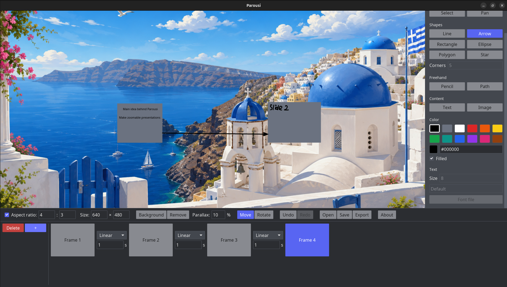
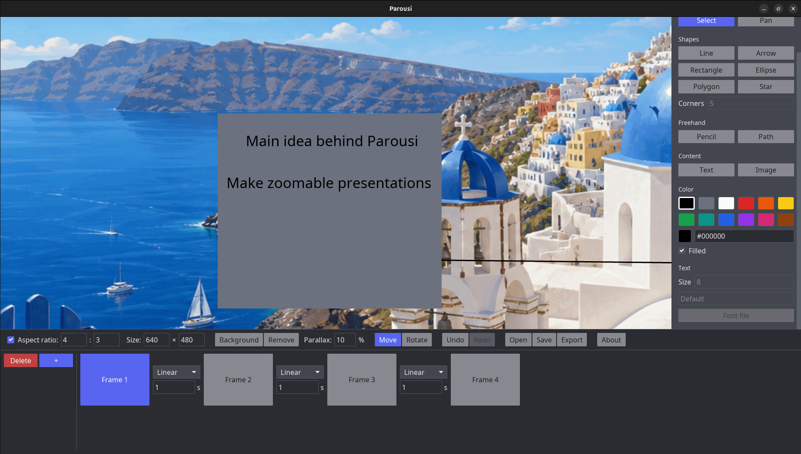
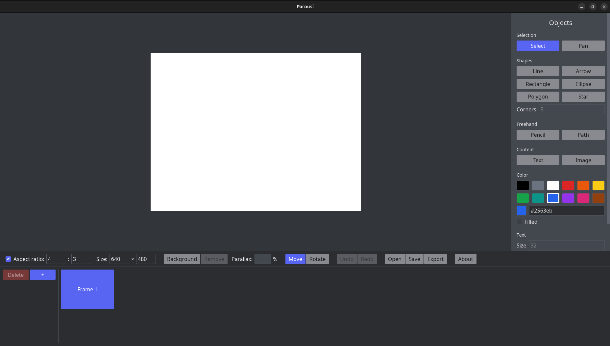
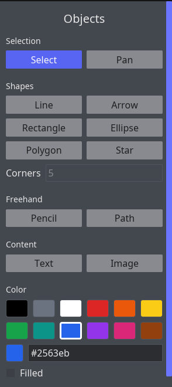
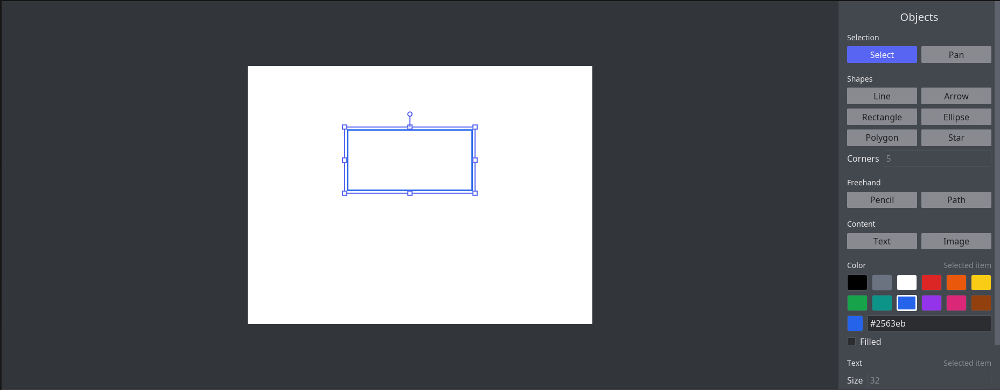
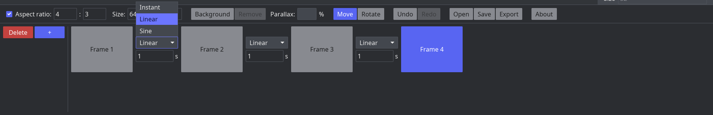
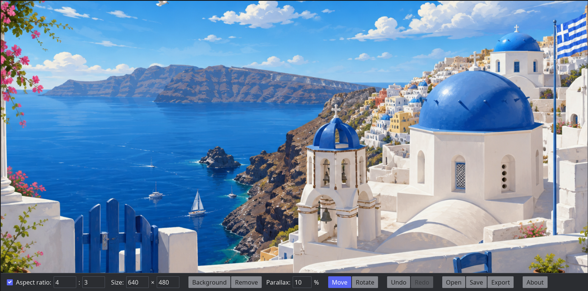
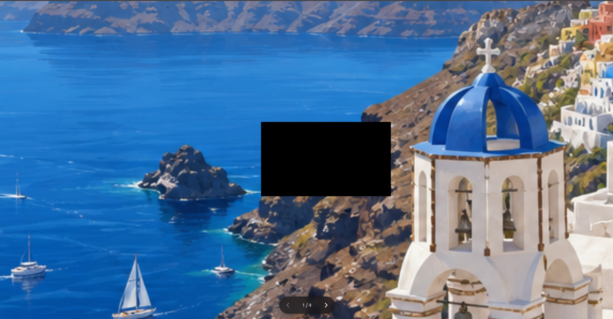

# Parousi

Parousi is a desktop presentation editor that works like a zoomable canvas. Instead of a stack of slides, you draw everything on one **board**. A presentation is a sequence of **frames**, and each frame is a camera view of that board. When the presentation plays, the camera flies from one view to the next, panning, zooming and rotating as it goes.

When it's ready, you can export the presentation as a **single, self-contained HTML file** that plays full screen in any modern browser. Viewers don't need Parousi installed.

<!-- Screenshot: the editor with a finished presentation open: board with a few
     shapes, text and an image, the Objects panel on the right, the toolbar and
     the timeline with several frames at the bottom. -->


<!-- Optional animated GIF: the camera flying between two frames (zoom + turn). -->


---

## Features

- **Drawing tools:** line, arrow, rectangle, ellipse, regular polygon, star, freehand pencil, multi-point path (open or closed), text and images.
- **Styling:** 12 preset colors or any hex color (`#rgb`, `#rrggbb`, with optional alpha), and a filled or outlined option for closed shapes.
- **Text:** any installed font, or a `.ttf`/`.otf` file loaded from disk. Fonts loaded from files are stored inside the presentation, so they display correctly on other machines.
- **Images:** PNG, JPEG, WebP, GIF, BMP, TIFF, TGA, QOI, ICO, PNM, HDR, EXR, DDS, and vector **SVG/SVGZ**, which are rasterized sharply enough for the maximum zoom.
- **Editing:** select, move, resize from any side or corner (Shift keeps proportions), rotate (Shift snaps to 15° steps), restyle and delete items.
- **Camera per frame:** pan, zoom (0.1× to 10×) and rotate the view of each frame. Slow rotations stop at right angles, so it's easy to straighten the view or an item again.
- **Transitions:** choose *Instant*, *Linear* or *Sine* (ease in and out) for each gap between frames, with a duration in seconds.
- **Parallax background:** an image fills the screen behind your drawings. It drifts and zooms slightly as the camera moves, which gives a sense of depth.
- **Board size and aspect ratio:** set the size of the board, optionally locked to an aspect ratio.
- **Undo and redo** for every change to the presentation. A continuous drag, scroll or typing session undoes as a single step.
- **Save and open:** `.parousi` files, which are ZIP archives that contain all images and fonts.
- **Export to HTML:** one file with everything embedded. You can step through it with the arrow keys or the on-screen buttons.

---

## Building

### Prerequisites

- **Rust 1.88 or newer** (the crate uses edition 2024). Install it with [rustup](https://rustup.rs).
- A GPU with Vulkan, Metal, DirectX 12 or OpenGL support. Without one, Parousi falls back to a software renderer.
- **Linux only:**
  - File dialogs need a running XDG Desktop Portal (`xdg-desktop-portal` plus a backend such as `-gtk`, `-gnome` or `-kde`), or `zenity` as a fallback.
  - `fc-match` (fontconfig) is optional. If it's installed, text inside SVG images uses a font that is actually installed on the system.

### Build and run

```bash
git clone <repository-url> parousi
cd parousi
cargo build --release
```

The binary is written to `target/release/parousi`. To build and run it in one step:

```bash
cargo run --release
```

> The repository vendors a patched copy of `iced_wgpu` in `vendor/iced_wgpu`. The patch fixes how rotated and large images are drawn. Cargo picks it up automatically through `[patch.crates-io]` in `Cargo.toml`, so you don't need to do anything.

---

## Using Parousi

<!-- Screenshot: the empty editor right after launch, ideally annotated with the
     four areas: 1 workspace, 2 Objects panel, 3 toolbar, 4 timeline. -->


The window has four areas:

| Area | What it does |
| --- | --- |
| **Workspace** (center) | The board, seen through the camera of the selected frame. You draw here. |
| **Objects panel** (right) | Tools, the corner count for polygons and stars, color, fill, and text size and font. |
| **Toolbar** (below the workspace) | Board aspect ratio and size, background and parallax, the Move/Rotate camera mode, Undo/Redo, Open/Save/Export, and About. |
| **Timeline** (bottom) | The frames in order. Between each pair of frames are the transition settings. **+** adds a frame and **Delete** removes the selected one. |

The **About** button opens a help window that lists all of the controls.

### Quick start

1. **Draw something.** Pick **Rectangle** under *Objects* and drag on the white board. Pick **Text**, click the board and type, then press <kbd>Esc</kbd> to finish.
2. **Frame the first view.** Drag an empty part of the board to pan, and hold <kbd>Ctrl</kbd> while scrolling to zoom.
3. **Add a second frame.** Click **+** in the timeline. The new frame starts with the same view, so pan and zoom to something else.
4. **Choose a transition.** Between *Frame 1* and *Frame 2*, pick *Sine* and type `1.5` seconds.
5. **Preview it.** Click *Frame 1*, then *Frame 2*. The camera flies between them the way the exported presentation will.
6. **Save** with <kbd>Ctrl</kbd>+<kbd>S</kbd>, then **Export** to get a `presentation.html` you can open in a browser.

### Tools

<!-- Screenshot: close-up of the Objects panel (tools, Corners, Color, Text). -->


| Tool | How to use it |
| --- | --- |
| **Select** | Click an item to select it, then drag it to move it. Dragging empty space pans the camera. |
| **Pan** | Drag anywhere, even over items, to move the camera. |
| **Line / Arrow** | Drag from the start point to the end point. |
| **Rectangle / Ellipse** | Drag across the area the shape should fill. |
| **Polygon / Star** | Drag from the center out to a corner. Set the number of corners or points (3–100) under *Corners*. |
| **Pencil** | Drag to draw freehand. |
| **Path** | Click to add points. Double-click or press <kbd>Enter</kbd> to finish, click the first point to close the shape, press <kbd>Backspace</kbd> to remove the last point, or press <kbd>Esc</kbd> to discard the path. |
| **Text** | Click where the text should go and type. <kbd>Enter</kbd> starts a new line. Press <kbd>Esc</kbd> or click elsewhere to finish. |
| **Image** | Drag out an area, or just click to use a default area, then pick an image file. The image keeps its aspect ratio. |

### Editing items

<!-- Screenshot: a rotated item selected, showing the blue outline, the eight
     square resize handles and the round turn handle above it. -->


- With **Select**, click an item. It gets an outline with **square handles** for resizing and a **round handle** for turning.
- Hold <kbd>Shift</kbd> while resizing to keep proportions, or while turning to snap to 15° steps.
- While an item is selected, the **Color** and **Text** sections change that item instead of new ones. The section titles show *Selected item* when this is the case.
- <kbd>Delete</kbd> or <kbd>Backspace</kbd> removes the selected item, and <kbd>Esc</kbd> deselects it.

### Frames and transitions

<!-- Screenshot: the timeline with 3-4 frames and the transition pickers
     (Instant / Linear / Sine + seconds) between them. -->


- Every frame shows the **same drawings**. Only the camera differs between frames.
- Moving the camera, whether by panning, zooming (<kbd>Ctrl</kbd> + scroll) or rotating, changes the **selected frame's** view.
- To rotate the camera, switch the toolbar mode from **Move** to **Rotate**, then drag around the center of the workspace.
- A transition belongs to the gap *before* a frame. Going backward plays the same transition in reverse.

### Background

<!-- Screenshot: a presentation with a background image, with drawings over it. -->


- **Background** in the toolbar fills the whole screen with an image *in place of* the white board. **Remove** takes it away again.
- **Parallax** (0–100 %, default 10) sets how far the background drifts as the camera moves from one edge of the board to the other. At 0 it stays still.
- When you zoom in, the background zooms too, but less, as if it were far behind the drawings.

### Saving, opening and exporting

| Action | Button | Shortcut |
| --- | --- | --- |
| Save | **Save** | <kbd>Ctrl</kbd>+<kbd>S</kbd> |
| Save as another file | none | <kbd>Ctrl</kbd>+<kbd>Shift</kbd>+<kbd>S</kbd> |
| Open a `.parousi` file | **Open** | <kbd>Ctrl</kbd>+<kbd>O</kbd> |
| Export as a web page | **Export** | none |

<!-- Screenshot: the exported presentation.html open in a browser, with the
     round navigation bar (‹ 2 / 5 ›) at the bottom. -->


In the exported page, use <kbd>→</kbd> or <kbd>Page Down</kbd> to go to the next frame, <kbd>←</kbd> or <kbd>Page Up</kbd> to go back, or the buttons at the bottom. Press <kbd>F11</kbd> in your browser for full screen. The page scales each frame to fit the browser window.

### Keyboard and mouse reference

| Input | Action |
| --- | --- |
| <kbd>Ctrl</kbd> + scroll | Zoom the camera around the cursor |
| Drag on empty board (Select) or anywhere (Pan) | Pan the camera; rotate it in **Rotate** mode |
| <kbd>Ctrl</kbd>+<kbd>Z</kbd> | Undo |
| <kbd>Ctrl</kbd>+<kbd>Shift</kbd>+<kbd>Z</kbd> or <kbd>Ctrl</kbd>+<kbd>Y</kbd> | Redo |
| <kbd>Ctrl</kbd>+<kbd>S</kbd> / <kbd>Ctrl</kbd>+<kbd>Shift</kbd>+<kbd>S</kbd> | Save / Save as |
| <kbd>Ctrl</kbd>+<kbd>O</kbd> | Open |
| <kbd>Delete</kbd> / <kbd>Backspace</kbd> | Delete the selected item |
| <kbd>Esc</kbd> | Deselect, finish text, or discard a path |
| <kbd>Shift</kbd> while resizing or turning | Keep proportions / snap to 15° |

On macOS, use <kbd>Cmd</kbd> instead of <kbd>Ctrl</kbd> for the shortcuts. Zooming uses <kbd>Ctrl</kbd> + scroll on every platform. The shortcuts also work with non-Latin keyboard layouts, such as Cyrillic.

---

## Common usage examples

**Overview, then zoom into the details.** Lay out a whole diagram on the board. Make Frame 1 show all of it. For each part you want to discuss, add a frame and <kbd>Ctrl</kbd>+scroll into that part. Use *Sine* transitions so the camera eases in and out.

**Turn the story around a corner.** Put the next section of content on the board rotated by 90° (select it and drag the round handle, which stops at right angles when you drag slowly). Switch to **Rotate** mode for that frame's camera and turn it to match. The camera rolls into the new orientation during the transition.

**A presentation with depth.** Add a wide landscape or texture as the **Background**, set **Parallax** to 20–30 %, and spread your frames across the board. As the camera travels, the background drifts behind the drawings.

**Branded typography.** Pick **Text**, click **Font file** and load your company's `.otf`. The font is embedded in both the `.parousi` file and the exported HTML, so it looks the same on the projector laptop.

**Annotated screenshots.** Use **Image** to place a screenshot, then draw over it with **Arrow**, **Ellipse** (unfilled) and **Text** to point at things. Add a frame that zooms in on each annotation.

**Hand it off.** **Export** and send the single `.html` file. It works offline, needs no plug-ins, and keeps every image and font inside it.

---

## Good to know

- Errors such as an unreadable image or a failed save are printed to the terminal (stderr). Start Parousi from a terminal if something seems to fail silently.
- Closing the main window quits immediately, **without asking to save**.
- Opening a presentation clears the undo history.
- Installed fonts are stored by name only. If a font isn't installed on the machine that opens the file, the text falls back to another font. Load the font as a **Font file** to embed it.
- The exported page shows each frame as the editor's workspace showed it when you exported, scaled to fit the browser window.

---

## Project layout

```
src/main.rs       App state, UI, drawing model, camera, tools, undo/redo
src/save.rs       .parousi file format (ZIP + JSON)
src/export.rs     HTML export
src/export.html   Page template and player script for exported presentations
src/typeface.rs   Installed fonts and embedded font files
vendor/iced_wgpu  Patched iced renderer (image rotation fix)
screenshots/      Images used by this README
```

For a detailed walkthrough of the code, see [ARCHITECTURE.md](ARCHITECTURE.md).
